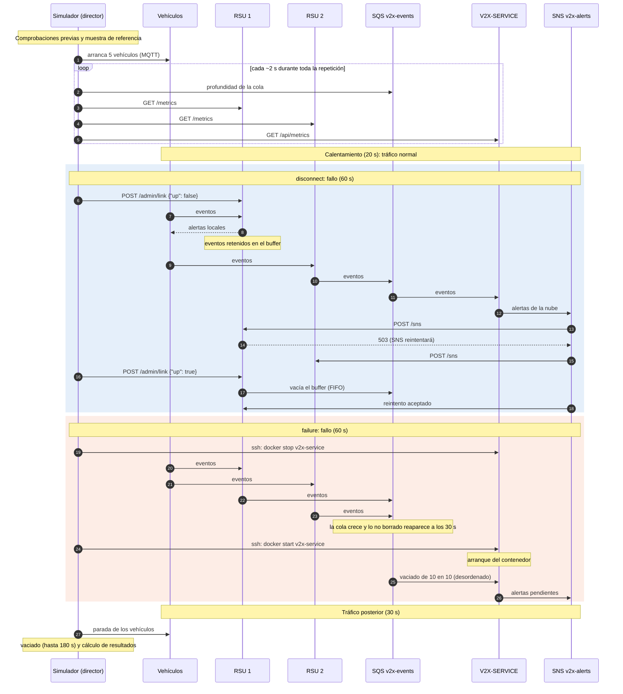

# Experimentos en AWS

Guía para lanzar los experimentos definitivos en el Learner Lab (`disconnect` y `failure`, 3 repeticiones cada uno) e interpretar los CSV para la memoria. Conviene haberlos ensayado antes en local (`PRUEBAS_LOCAL.md`).

**Tiempo necesario.** Cada repetición dura unos 2-3 minutos con los valores por defecto (20 s de calentamiento, 60 s de corte, 30 s posteriores y el vaciado). Con `--repeat 3`, unos 10 minutos por experimento. Junto con el despliegue y las comprobaciones, menos de 1 hora: cabe de sobra en una sesión de 4 horas del laboratorio.

## 1. Requisitos en el portátil
- Python 3.10 o superior, con el entorno virtual `.venv` creado y las dependencias instaladas según el apartado **"Entorno virtual de Python"** del `README.md` (solo la primera vez). En cada terminal donde se lance el simulador, activarlo antes:
  ```powershell
  .venv\Scripts\Activate.ps1      # PowerShell
  .venv\Scripts\activate.bat      # CMD
  source .venv/Scripts/activate   # Git Bash
  ```
- Credenciales del laboratorio en `C:\Users\<usuario>\.aws\credentials`. Se copian de **AWS Details → AWS CLI: Show** y caducan en cada sesión:
  ```ini
  [default]
  aws_access_key_id=...
  aws_secret_access_key=...
  aws_session_token=...
  ```
  El simulador las usa para encontrar las instancias por su etiqueta y para leer SQS y DynamoDB.
- Para `failure`: la clave `labsuser.pem` (**AWS Details → Download PEM**) en la carpeta del proyecto y `ssh` disponible en la terminal. En Windows, quitar permisos a otros usuarios o `ssh` la rechaza:
  ```powershell
  icacls labsuser.pem /inheritance:r /grant:r "$($env:USERNAME):(R)"
  ```

## 2. Preparar la sesión
1. **Start Lab** y esperar al indicador verde.
2. Actualizar las credenciales en `.aws\credentials` y en los 3 secretos `AWS_*` de GitHub.
3. Lanzar el workflow desde **Actions → Run workflow**, aunque no haya cambios: las instancias cambian de DNS al reiniciar el laboratorio y las RSU tienen que volver a suscribirse a SNS. Esperar a que termine en verde.
4. Borrar de `results/` los CSV de ensayos anteriores, para no mezclarlos.

## 3. Comprobar el despliegue
El workflow en verde **no garantiza** que el sistema funcione: solo comprueba que los contenedores arrancan. Antes de medir:

```bash
# Las 2 suscripciones deben tener un ARN completo, no "PendingConfirmation"
TOPIC=$(aws sns create-topic --name v2x-alerts --query TopicArn --output text)
aws sns list-subscriptions-by-topic --topic-arn "$TOPIC" --query "Subscriptions[].[Endpoint,SubscriptionArn]" --output table

# DNS públicos de las 3 instancias
aws ec2 describe-instances --filters "Name=tag:Name,Values=v2x-rsu1,v2x-rsu2,v2x-service" "Name=instance-state-name,Values=running" \
  --query "Reservations[].Instances[].[Tags[?Key=='Name']|[0].Value,PublicDnsName]" --output table
```

`create-topic` con un nombre existente solo devuelve su ARN, no crea nada. Después, en el navegador (con `http://`):
- `http://<DNS de v2x-rsu1>:8080/metrics` y `http://<DNS de v2x-rsu2>:8080/metrics` responden con `"link_up": true`.
- `http://<DNS de v2x-service>:5000` muestra el dashboard y `/api/metrics` responde.

Si una suscripción sigue en `PendingConfirmation`, la RSU no recibió la confirmación de SNS: relanzar el workflow.

## 4. Prueba de humo
Un minuto de tráfico normal para confirmar las dos rutas antes de los experimentos:

```bash
python vehicle_simulator.py --duration 60 --run-id aws-smoke
```

Debe verse en la consola:
- Alertas `(rsu-1)` y `(rsu-2)`: alertas locales, en unos cientos de ms (~300-400). Casi todo ese tiempo es la ida y vuelta entre el portátil y us-east-1, no el procesado de la RSU.
- Alertas `(cloud)` en vehículos de **ambas** RSU: confirman que SNS entrega por HTTP a las dos.
- Cambios de RSU (`<> [veh-...] cambio de ...`) sin errores.

Y en el dashboard, los 5 coches moviéndose y alertas en el panel. Si no aparece ninguna alerta `cloud`, revisar las suscripciones del paso 3 antes de seguir.

## 5. Lanzar los experimentos

```bash
python vehicle_simulator.py --experiment disconnect --repeat 3 --run-id aws-disconnect
python vehicle_simulator.py --experiment failure --repeat 3 --run-id aws-failure --ssh-key labsuser.pem
```

Si en `failure` el SSH muestra `WARNING: UNPROTECTED PRIVATE KEY FILE!` (seguido de `Permission denied (publickey)`), `ssh` ha ignorado la clave porque otros usuarios de Windows pueden leerla. Ejecutar en PowerShell, desde la carpeta del proyecto, y relanzar el experimento:

```powershell
icacls labsuser.pem /inheritance:r /grant:r "$($env:USERNAME):(R)"
```

| Experimento | Fallo que inyecta | Cómo se restaura |
|---|---|---|
| `disconnect` | `POST /admin/link {"up": false}` en la RSU 1: deja de enviar a SQS (guarda en su buffer) y responde 503 a SNS, que reintenta | `{"up": true}` tras `--outage` s |
| `failure` | `sudo docker stop v2x-service` por SSH en la instancia del servicio | `sudo docker start v2x-service` |

No tocar el sistema ni lanzar otros simuladores mientras corren: alterarían los contadores. Si una repetición falla a mitad (por ejemplo, caducan las credenciales), se relanza el experimento completo con otro `--run-id` (`aws-disconnect-v2`, `aws-failure-v2`...). Reutilizar un `--run-id` mezclaría en DynamoDB los eventos de ambos intentos y daría pérdidas negativas. El simulador lo impide: se detiene si ya hay eventos con ese `run_id`.

Antes de cada repetición, el simulador:
- Restaura, con un `AVISO`, el enlace de una RSU que siga cortado o el servicio si está parado. Es lo que queda si un experimento se interrumpe a mitad del corte.
- Espera a que los buffers de las RSU y la cola estén vacíos.

El corte se deshace siempre, aunque se pulse Ctrl+C o falle algo durante `--outage`.

Para la memoria: el corte de `disconnect` es lógico, no de red. La RSU deja de usar el enlace por orden del experimento, lo que permite repetirlo con la misma duración exacta. El efecto sobre el sistema (eventos retenidos, SNS sin respuesta) es el mismo que el de un corte real.

## 6. Qué ocurre durante un experimento

El simulador hace a la vez de flota de vehículos y de director del experimento. Cada repetición pasa por las mismas fases. Los tiempos son los valores por defecto:

1. **Comprobaciones previas.** El simulador:
   - se detiene si DynamoDB ya tiene eventos con ese `run_id`;
   - restaura el enlace de una RSU que siga cortado o arranca el servicio si está parado;
   - espera, hasta `--drain-timeout`, a que no quede nada en los buffers de las RSU ni en la cola.
2. **Muestra de referencia.** Lee los contadores de las RSU y del servicio antes de generar tráfico, para contar después solo lo que ocurra en la repetición.
3. **Arranque.** Se conectan los 5 vehículos por MQTT, cada uno a la RSU de su carril. Arranca un hilo que toma una muestra cada ~2 s en AWS:
   - mensajes visibles y en proceso en SQS;
   - `GET /metrics` de las dos RSU;
   - `GET /api/metrics` del servicio.

   Cada muestra es una fila de `_timeline.csv`.
4. **Calentamiento (20 s).** Tráfico normal: los eventos llegan a DynamoDB y las alertas vuelven a los vehículos.
5. **Fallo (60 s).** Se inyecta el fallo del experimento (ver abajo). Los vehículos siguen circulando, generando eventos y cambiando de RSU.
6. **Restauración.** Se deshace el fallo. Ocurre siempre, aunque se pulse Ctrl+C durante el corte.
7. **Tráfico posterior (30 s).** El sistema vacía lo acumulado mientras sigue llegando tráfico nuevo.
8. **Parada y vaciado.** Se paran los vehículos. El simulador espera a que la cola y los buffers lleguen a 0, como mucho `--drain-timeout` (180 s), y deja 5 s de margen.
9. **Cálculo de resultados.** El simulador:
   - cuenta en DynamoDB los eventos distintos del `run_id`;
   - comprueba que el estado guardado de cada vehículo corresponde a su evento más reciente;
   - escribe los tres CSV.

### `disconnect`: desconexión de la RSU 1

- **Inyección del fallo:** `POST /admin/link {"up": false}` en la RSU 1. Es un corte lógico: la RSU sigue recibiendo eventos por MQTT, pero deja de usar el enlace con AWS.
- **RSU 1 durante el corte:**
  - los eventos que superan la validación y el filtrado se acumulan en su buffer, en orden (`rsu-1_buffered` crece);
  - las alertas locales (frenazos y congestión del tramo) siguen llegando a sus vehículos;
  - cuando SNS le entrega una alerta de la nube, responde 503, y SNS la reintenta según su política (hasta 10 veces, con esperas de 1 a 20 s).
- **El resto del sistema** funciona con normalidad. La RSU 2 sigue enviando a SQS y el servicio sigue procesando y publicando alertas. Los coches que pasan de la RSU 1 a la RSU 2 durante el corte siguen enviando eventos por la RSU 2.
- **Restauración:** `POST /admin/link {"up": true}`. La RSU 1 vacía su buffer a SQS en orden y acepta los reintentos pendientes de SNS. Por eso:
  - sus vehículos reciben tarde alertas de la nube;
  - aparecen eventos antiguos en la nube después de otros más recientes del mismo coche, que llegaron por la RSU 2 (`cross_rsu`).

### `failure`: parada de V2X-SERVICE

- **Inyección del fallo:** `sudo docker stop v2x-service` por SSH en la instancia del servicio. En local, `docker stop v2x-service`.
- **Durante la parada:**
  - las RSU no notan nada: siguen enviando a SQS sin errores, así que su buffer se mantiene cerca de 0;
  - la cola crece (`queue_visible`), porque nadie la consume;
  - los mensajes que el servicio había recibido pero no borrado vuelven a estar visibles a los 30 s (tiempo de visibilidad);
  - no se generan alertas de la nube y el dashboard no responde (`service_up` = `False`);
  - las alertas locales siguen funcionando.
- **Restauración:** `sudo docker start v2x-service`.
  - El contenedor tarda unos segundos en arrancar y volver a responder; la mayor parte de `recovery_s` es este arranque.
  - Después, el servicio vacía la cola de 10 en 10 mensajes con sondeo largo. SQS estándar los entrega desordenados (`same_rsu`), y las escrituras condicionales en DynamoDB mantienen correcto el estado final.
  - Los contadores del servicio vuelven a 0 al reiniciarse; el simulador los acumula para no perder lo contado antes de la parada.
  - Las alertas de eventos que esperaron en la cola llegan con decenas de segundos de retraso.

La Figura 1 resume la secuencia de cada experimento.



*Figura 1. Secuencia de una repetición de cada experimento. Los dos bloques de color son alternativos: cada repetición ejecuta solo el del experimento elegido.*

## 7. Resultados
En `results/` quedan, por experimento:
- `aws-disconnect_summary.csv`: 3 filas, una por repetición. Es la tabla principal de la memoria.
- `aws-disconnect-1_timeline.csv` ... `-3`: una muestra cada ~2 s, para las gráficas. Cada muestra consulta desde el portátil las 2 RSU, el servicio y SQS, y en AWS eso lleva más de 1 s.
- `aws-disconnect-1_alerts.csv` ... `-3`: una fila por alerta recibida por cada vehículo.

Y lo mismo con `aws-failure`. Guardarlos fuera del portátil (repo o carpeta compartida) en cuanto terminen.

## 8. Interpretar el resumen

### Experimento `disconnect` (familia comunicación)
Lo que pide el enunciado y la columna que lo responde:

| Pregunta | Columna | Resultado esperado |
|---|---|---|
| ¿Cuántos eventos quedaron retenidos? | `peak_rsu_buffer` | Del orden de los eventos que la RSU 1 reenvía en 60 s (unas decenas, según cuántos coches estén en su tramo) |
| ¿Se rechazó o descartó algo? | `rsu_dropped` | 0: el buffer (5000) no se llena en 60 s |
| ¿Se perdieron eventos? | `lost` | **0** |
| ¿Se mantiene el orden tras reconectar? | `out_of_order_same_rsu_after_restore` | Unas decenas (32-36 en los primeros intentos). El buffer de la RSU es FIFO, pero al vaciar de golpe decenas de mensajes, SQS estándar los entrega desordenados. Con tráfico normal no hay inversiones. En LocalStack sale ~0 porque su cola se comporta casi como FIFO |
| ¿Por qué hay eventos desordenados? | `out_of_order_cross_rsu_after_restore` | La mayoría del desorden: coches que cambiaron a la RSU 2 durante el corte y cuyos eventos antiguos salieron después del buffer de la RSU 1 |
| ¿Cuánto tarda en recuperarse? | `recovery_s` | Pocos segundos tras restaurar |
| ¿El estado final es correcto? | `final_state_ok` | **true** |
| ¿Siguen funcionando las alertas locales? | `p95_local_alert_ms` | ~350-380 ms, igual que sin corte: no dependen de la nube. La cifra la marca la red entre el portátil y us-east-1 |

### Experimento `failure` (familia recuperación)

| Pregunta | Columna | Resultado esperado |
|---|---|---|
| ¿Cuánto crece la cola? | `peak_queue_visible` | Todo lo que las RSU reenvían durante los 60 s (decenas o algo más de 100) |
| ¿Quedan mensajes sin procesar? | `lost`, `dlq_depth` | 0 y 0 |
| ¿Hay duplicados y reintentos? | `cloud_redelivered`, `cloud_duplicates` | Pocos (0-2): mensajes recibidos justo antes de parar el servicio, que SQS reentrega a los 30 s. La idempotencia los descarta |
| ¿Cuánto tarda en recuperarse? | `recovery_s` | 10-15 s. Casi todo es el arranque del contenedor (`docker start`, Python y boto3); ya arrancado, vacía ~120 mensajes en menos de 5 s con long polling |
| ¿El estado final es correcto? | `final_state_ok` | **true** |
| ¿Afecta a las RSU? | `peak_rsu_buffer`, `rsu_retries` | ~0: las RSU siguen enviando a SQS con normalidad |
| ¿Se procesa en orden al volver? | `out_of_order_same_rsu_after_restore` | No del todo: unas decenas (59-73 en los primeros intentos). Al vaciar ~100 mensajes acumulados, SQS estándar los entrega desordenados. `final_state_ok` sigue siendo true porque el servicio nunca sobrescribe con un evento antiguo |
| ¿Y el desorden de distinta RSU? | `out_of_order_cross_rsu_after_restore` | 20-35, y también lo causa SQS. Aquí no hay buffer en la RSU y las dos RSU envían en orden. Pero si un coche cambió de RSU durante los 60 s, al barajar SQS la cola su evento más reciente puede venir de la otra RSU. La clasificación por RSU solo aísla la causa en `disconnect` |

### Columnas comunes

| Columna | Lectura |
|---|---|
| `generated` / `published` | Eventos creados / publicados por MQTT. Iguales sin inyección de anomalías |
| `rsu_forwarded` / `stored_distinct` | Reenviados por las RSU / guardados en DynamoDB. Menos que `published` porque la RSU filtra telemetría normal a propósito; por eso `lost` se calcula entre estas dos y no con `published` |
| `cloud_out_of_order` | Total de eventos adelantados por otro más reciente del mismo vehículo. Siempre = `same_rsu` + `cross_rsu`. No afecta al estado: el servicio nunca sobrescribe con un evento antiguo |
| `cloud_errors` | Debe ser 0. Si no, ver `sudo docker logs v2x-service` en la instancia |
| `p95_cloud_alert_ms` | Cercano a la duración del corte en ambos experimentos: incluye las alertas de eventos que esperaron en el buffer o en la cola. Sin corte (prueba de humo), unos cientos de ms. Las latencias las mide el reloj del portátil en ambos extremos, sin desfase entre máquinas |
| `handovers` / `handover_failures` / `p95_handover_ms` | Cambios de RSU de la ejecución, fallidos (0) y su duración. En AWS, ~300-375 ms (frente a decenas de ms en local), por la latencia portátil-EC2 |

### Para la memoria
- **Media y dispersión.** Con 3 repeticiones, dar la media y el rango (mínimo-máximo) de `peak_*`, `recovery_s`, `p95_*` y del desorden. `lost`, `dlq_depth` y `final_state_ok` deben ser iguales en las 3.
- **Gráficas** a partir de `_timeline.csv` (`t` en el eje X):
  - `disconnect`: `rsu-1_buffered` sube de forma lineal durante el corte y cae a 0 al restaurar.
  - `failure`: `queue_visible` sube mientras `service_up` es `False` y baja al volver el servicio. `service_processed` vuelve a 0 al reiniciarse el contenedor (sus contadores están en memoria).
  - `queue_visible` es `ApproximateNumberOfMessages` de SQS: va con retraso y oscila. En `failure` puede marcar 0 durante los primeros ~30 s del corte. Durante el vaciado puede saltar entre 0 y más de 100. Y en `disconnect` puede no verse el pico al vaciarse el buffer, porque la cola se vacía entre dos muestras. Indicarlo en el pie de la gráfica.
  - La precisión temporal es la del muestreo, ~2 s en AWS. Afecta a `recovery_s` y a las columnas `*_after_restore`.
  - Marcar con líneas verticales el inicio del corte (`--warmup`, 20 s) y la restauración (80 s).
- **Alertas.** En `_alerts.csv`, comparar la latencia de `origin` = `rsu-*` con la de `cloud`. Las alertas `cloud` con latencia de decenas de segundos son de eventos retenidos durante el corte: la caducidad de alertas no está implementada, y se indica como limitación.
- **Comparación con local.** Las cifras de pérdida, orden y estado final deben coincidir con el ensayo local; los tiempos no, porque en AWS hay latencia de red real.

## 9. Problemas frecuentes

| Síntoma | Causa y solución |
|---|---|
| `ModuleNotFoundError: No module named 'paho'` (o `boto3`) | El entorno virtual no está activado en esa terminal. Activarlo o usar `.venv\Scripts\python.exe` |
| `Instancias EC2 no encontradas o paradas` | El laboratorio está parado o las instancias no se han creado. Start Lab y relanzar el workflow |
| `ExpiredToken` o `InvalidClientTokenId` | Credenciales de `.aws\credentials` caducadas. Copiarlas de nuevo desde AWS Details |
| `El experimento 'failure' en AWS necesita --ssh-key labsuser.pem` | Falta la opción `--ssh-key` en el comando |
| `UNPROTECTED PRIVATE KEY FILE` | Permisos de `labsuser.pem`. Ver el comando `icacls` del apartado 1 |
| `Permission denied (publickey)` | La clave no es la del laboratorio actual. Descargar de nuevo el PEM |
| `DynamoDB ya tiene N eventos con run_id ...` | Ese `--run-id` ya se usó en un intento anterior. Relanzar con otro (`aws-disconnect-v2`) |
| `El sistema sigue con eventos pendientes tras 180 s` | Una RSU no vacía su buffer o el servicio no consume la cola. Ver `/metrics` de las RSU y `sudo docker logs v2x-service` |
| `lost` negativo | El `run_id` se reutilizó y DynamoDB mezcla eventos de dos intentos (solo pasa con resultados anteriores a la comprobación previa). Repetir con otro `--run-id` |
| Ninguna alerta `cloud` | Suscripciones SNS sin confirmar o con el DNS de una sesión anterior. Relanzar el workflow y repetir el paso 3 |
| Timeout al conectar por MQTT o HTTP | El security group `v2x-sg` no tiene abiertos 1883/8080/5000, o la red de la universidad los bloquea. Probar desde otra red |
| `recovery_s` vacío | El sistema no bajó de 10 eventos pendientes antes de `--drain-timeout` (180 s). Ver `_timeline.csv` y los logs del servicio |
| `final_state_ok` false | Algún evento no se guardó o el vaciado no terminó. Revisar `lost`, `dlq_depth` y `cloud_errors` |
